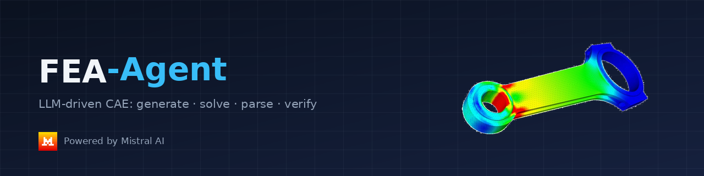
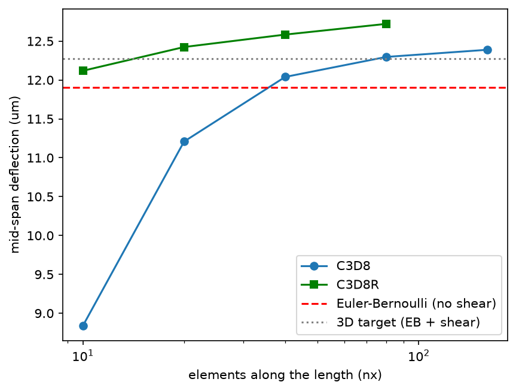

  

  
  
  
  

<em>An LLM-driven agent for CAE/FEA simulation: generate the model, run the solver,
parse results, and verify them against physics — because an answer is worthless
until verifiers have checked it.</em>

---

## Phase 0: pilot run and convergence study

Simply supported steel beam (L = 1 m, 100 x 100 mm section), 1000 N point load at
mid-span, solved with CalculiX ccx 2.21 (WSL Ubuntu). Analytic references (SI):

- reactions: 500 N per support
- mid-span deflection (Euler-Bernoulli): 1.190e-5 m
- max bending stress: 1.5e6 Pa

Sanity checks pass on every run: support reactions sum to 1000 N at machine precision.

### Mesh convergence (deflection, ny = 16, nz = 8)

| element | nx  | deflection (µm) | vs Euler-Bernoulli (11.905) |
| ------- | --- | --------------- | ---------------------------- |
| C3D8    | 10  | 8.840           | −25.7% |
| C3D8    | 20  | 11.208          | −5.9%  |
| C3D8    | 40  | 12.039          | +1.1%  |
| C3D8    | 80  | 12.297          | +3.3%  |
| C3D8    | 160 | 12.389          | +4.1%  |
| C3D8R   | 10  | 12.119          | +1.8%  |
| C3D8R   | 20  | 12.424          | +4.4%  |
| C3D8R   | 40  | 12.584          | +5.7%  |
| C3D8R   | 80  | 12.722          | +6.9%  |

*C3D8 converges from below (shear locking, effective order ~1.5); C3D8R crosses the
converged value at nx=20 — by cancellation of locking and hourglass errors — then drifts
above it (over-flexibility signature on slender elements). Euler-Bernoulli (dashed) is
a lower bound at L/h = 10, not the truth: the 3D solution is ~4.5% above the school formula.*

Lessons (they directly shape the verifier library of phase 1):

1. **Fully integrated C3D8 locks in bending.** It converges from below, slowly,
   dominated by the element count along the length, settling near 12.44 µm.
2. **Reduced integration C3D8R is erratic.** A 3-point study would have wrongly
   concluded that C3D8R is excellent; a systematic 9-run series reveals its drift.
3. **Euler-Bernoulli is a bounded approximation, not the truth.** A verifier that
   demands "1.19e-5 within 1%" would reject better physics than the formula itself.

### Workflow hygiene, learned the hard way

- result files carry the element type and mesh in their name: no silent overwrites
- a result is only read if it is fresher than the input that produced it
- convergence claims need a systematic series, not 3 points

## Layout

    scripts/make_beam_inp.py     parametric 3PB deck generator (nx ny nz, --reduced)
    scripts/plot_convergence.py  convergence chart from ccx .dat outputs
    docs/                        banner and figures
    verifiers/                   (phase 1) physics verification library + pytest

## Try it

    python -m venv .venv && source .venv/bin/activate
    pip install -r requirements.txt
    # install the solver: sudo apt install calculix
    python scripts/make_beam_inp.py 20 16 8 && ccx beam_c3d8_20_16_8

## Roadmap

- Phase 1: verifiers/ — equilibrium, bounds, convergence-rate checks as a tested library
- Phase 2: Gmsh inputs, quadratic tetrahedra (C3D10), 3D visualization of results
- Phase 3: LLM loop benchmark — tasks x models x verifiers under identical conditions,
  cold-start report with verifiable numbers

*Every phase produces commits, tags, figures and honest numbers, produced and
verified in the open.*
