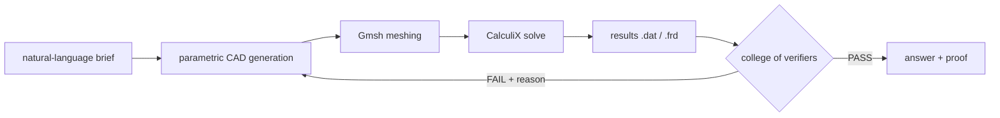

# FEA-Agent


> An LLM agent that runs mechanical simulations end to end:
> geometry → meshing → CalculiX → post-processing,
> **with verifiers that prove every result.**

## The idea

An LLM can write a CalculiX deck in seconds. The real question is no longer "can it compute?" but "**can it be trusted?**" This project's answer: trust does not come from the model, it comes from **hand-written verifiers** — physics judges (equilibrium, analytic bounds, convergence, sanity) that accept or reject every run with a quantified reason. Around them, three building blocks:

- **verifiers** (Phase 1): the physics judges, each tested against healthy *and* poisoned cases;
- **harness** (Phase 2): the agent loop — plan → simulate → verify → replan;
- **benchmark** (Phase 3): verifiable tasks with hand-computed ground truths, up to an RLVR reward model where the training reward is a verifier saying PASS.

## Expected workflow



## Progress

```text
Phase 0  Reference study          [████████████████████] 100%  (tag 0.1)
Phase 1  Verifiers module         [████████████████████] 100%  (tag 1.0)
Phase 2  Agent harness            [░░░░░░░░░░░░░░░░░░░░]  0/7
Phase 3  Dataset & benchmark      [░░░░░░░░░░░░░░░░░░░░]  0/6
Phase 4  SFT / RLVR (optional)    [░░░░░░░░░░░░░░░░░░░░]  0/6
```

The detailed plan lives in a private tracker; this README is its public mirror, updated at every step.

## Phase 0 — reference study (tag `0.1`)

Understand the solver and its traps on a textbook case **before** trusting an agent: three-point bending beam, 1000 N, steel 100×100 mm, L = 1 m. A 9-run campaign C3D8 vs C3D8R at increasing mesh densities (nx = 10 → 160), mid-span deflection compared to the Euler-Bernoulli formula (11.9 µm).


**Lessons** (which became the oracles of the Phase 1 tests):

- **C3D8 shear locking**: a coarse mesh is an over-stiff model (8.84 µm at nx = 10, i.e. −26% vs analytic);
- **deceptive C3D8R**: seemingly accurate on coarse meshes but non-monotonic — three points would have wrongly concluded "stable";
- **Euler-Bernoulli is a lower bound**: the converged 3D answer sits ~4.5% above it (shear strain neglected by the theory), reference deflection ≈ **12.4 µm** (last refinement gap < 1%).

## Phase 1 — the verifiers module (in progress)

A college of judges, each tested against healthy cases **and** poisoned cases ("detect, never crash"):

| Verifier | Rule | Example of rejected poison |
| --- | --- | --- |
| `equilibrium` | Σ reactions = applied load, relative tolerance | reactions 400 + 500 vs load 1000 |
| `bounds` | multiplicative band `[ref/1.15 ; ref×1.15]`, two-sided | mm↔m (ratio ×1000), locked mesh (ratio 0.74) |
| `convergence` | last refinement moves the quantity by < 2% | oscillating series, reversed series |
| `ccx_io` | parse `.dat` into clean dicts | stray numeric line → `ValueError` with line number |
| `cli` | `python -m verifiers run_dir`: one verdict per judge + exit code 0/1 | run box without exactly one `.dat` → `ValueError` |
| `stress` | tension fiber sigma_xx vs closed-form sigma_max (Saint-Venant) | load-zone peaks, stresses 1000x off |

Status: **44 tests green**. Oracles are the real Phase 0 numbers (hand-computed or measured), never copies of the code under test.

## Getting started

```bash
git clone https://github.com/thefrip29/fea-agent
cd fea-agent
python3 -m venv .venv && source .venv/bin/activate
pip install -e .
python -m pytest -v        # 25 tests: no other dependency required
```

Re-running the simulations requires `gmsh` and `ccx` (CalculiX); see `scripts/make_beam_inp.py` and `scripts/status.sh`.

## Repository layout

```text
fea-agent/
├── solutions/    the answer key: closed-form analytic formulas (3PB bending, tension)
├── verifiers/    the judges: equilibrium, bounds, convergence + .ccx parser
├── tests/        the judges of the judges: healthy + poisoned cases
├── tasks/        (Phase 3) benchmark briefs in YAML
├── scripts/      parametric deck generator, status snapshot, plots
└── Output/       Phase 0 runs (not versioned)
```

## Reports

> One dated report per work session: objective, method, results, proof.

### 2026-11-26 — Judging simulation results

**Objective.** Decide whether a CalculiX result can be trusted *without re-running it*: the trust layer any future agent must pass through.

**Method.** Three hand-written judges, independent from the solver. **Equilibrium**: the reaction sum must match the applied load at relative tolerance. **Analytic bounds**: every quantity must live in the two-sided multiplicative band `[ref/1.15 ; ref×1.15]` around its closed-form reference — far *below* betrays an over-stiff (locked) model, far *above* betrays units or load errors. **Convergence**: a refinement series is accepted only when the last step moves the quantity by less than 2%, and the verdict carries the whole series.

**Results.** 25 tests green. Oracles are the real Phase 0 numbers: the converged run passes, the locked coarse mesh is rejected at 0.74, the mm↔m error at ~×1000, oscillating and reversed series at > 10%. Every verdict carries a quantified reason, readable by a human or an agent. Code: `b58eaae`, `<hash>`, `<hash>`.

**Next.** Parse the `.frd` field data (von Mises), orders-of-magnitude sanity checks, and a single CLI entry point so any run directory gets a PASS/FAIL verdict.

### 2026-11-24 — Data layer and analytic answer key

**Objective.** Give the pipeline its two inputs: clean structures read from the solver output, and an analytic reference to judge against.

**Method.** A state-machine parser for the `.dat` output (known blocks consumed, unknown blocks tolerated, stray numeric lines rejected with their line number) and a library of closed-form formulas (three-point bending, tension) as pure SI functions, validated once against hand computations.

**Results.** 12 tests green against hand-computed oracles (δ = 1.19e-5 m, σ = 1.5 MPa — the Phase 0 numbers); integration on the real campaign run green. Code: `b58eaae`, `be1002e`, `12b973c`.

### 2026-11-22 — Reference campaign closed (tag `0.1`)

**Summary.** 9-run C3D8 vs C3D8R convergence campaign on the textbook beam; reference deflection ≈ 12.4 µm; locking and deceptive-monotonicity lessons now embedded in the tests. Details in the Phase 0 section above.

---

*Powered by Mistral — banner assembled from a CalculiX FEA render and the Mistral logo.*
